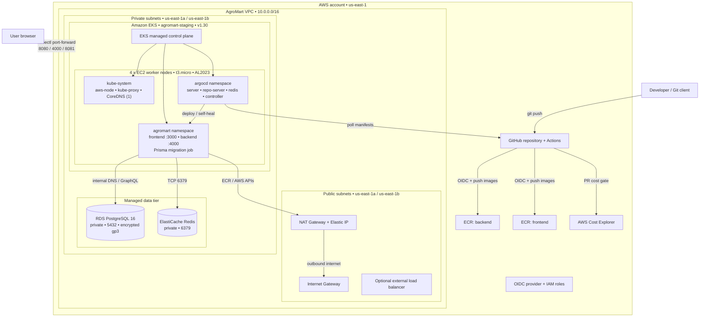
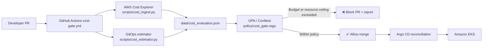

# AgroMart Cost-Aware GitOps

AgroMart is an AWS and Kubernetes reference project for **shift-left FinOps**:
it evaluates the cost and resource impact of GitOps changes before they are
merged and synchronized to Amazon EKS.

The marketplace application is the workload used to exercise the platform. The
primary engineering focus of this repository is the **Cost-Aware GitOps Gate**,
the Terraform-managed AWS foundation, Argo CD delivery, and operational
guardrails around Kubernetes resources.

## Why this project exists

Traditional GitOps continuously reconciles the desired state in Git, but does
not ask whether a change is affordable. This project adds a policy checkpoint
before deployment:

1. A pull request changes Kubernetes manifests or cost policy.
2. GitHub Actions ingests month-to-date spend and estimates the proposed
   workload cost.
3. OPA/Conftest evaluates namespace budgets and compute ceilings.
4. The workflow comments a cost report on the pull request and blocks a budget
   breach.
5. Approved changes merge and Argo CD reconciles them to EKS.

## AWS cloud architecture

The platform runs in `us-east-1` with EKS workloads and managed data services
in private subnets. GitHub Actions authenticates to AWS using OIDC; no long-
lived AWS access keys are required by the deployment workflow.



The diagram is also documented in
[`DEPLOYMENT_ISSUES_AND_ARCHITECTURE.md`](./DEPLOYMENT_ISSUES_AND_ARCHITECTURE.md).
The architecture document also describes the optional AWS-icon SVG rendering
workflow with the [`diagrams`](https://pypi.org/project/diagrams/) package and
[Graphviz](https://graphviz.org/download/).

## Repository layout

| Path | Responsibility |
|---|---|
| [`infra/`](./infra/) | Terraform for VPC, EKS, ECR, RDS, ElastiCache, IAM, and security groups |
| [`gitops/`](./gitops/) | Kubernetes workload manifests, namespaces, Argo CD application, and budgets |
| [`policy/`](./policy/) | OPA/Rego rules for budget, CPU, and memory enforcement |
| [`scripts/cost_ingest.py`](./scripts/cost_ingest.py) | Reads AWS Cost Explorer spend or generates local mock spend |
| [`scripts/cost_estimator.py`](./scripts/cost_estimator.py) | Converts GitOps resource requests into projected monthly cost |
| [`scripts/cost_exporter.py`](./scripts/cost_exporter.py) | Exposes cost evaluation data as Prometheus metrics |
| [`scripts/test_cost_gate.py`](./scripts/test_cost_gate.py) | PASS, DENY, and authorized-override validation scenarios |
| [`.github/workflows/cost-gate.yml`](./.github/workflows/cost-gate.yml) | Pull-request cost evaluation and enforcement |
| [`.github/workflows/deploy.yml`](./.github/workflows/deploy.yml) | Build, scan, push, and GitOps image-tag update workflow |
| [`monitoring/cost-dashboard.json`](./monitoring/cost-dashboard.json) | Grafana dashboard definition |
| `backend/`, `frontend/` | Example GraphQL marketplace workload |

## Cost-Aware GitOps Gate

### Gate flow



### Policy inputs and decisions

[`gitops/budgets.yaml`](./gitops/budgets.yaml) defines per-namespace:

- monthly budget in USD;
- warning threshold percentage;
- maximum requested CPU cores; and
- maximum requested memory in GiB.

The estimator scans `Deployment` resources under `gitops/`, multiplies
container resource requests by replica count, and applies the reference rates
defined in [`scripts/cost_estimator.py`](./scripts/cost_estimator.py):

```text
projected monthly workload cost =
    requested CPU cores × CPU monthly rate
  + requested memory GiB × memory monthly rate
```

The policy denies a change when projected spend exceeds the namespace budget,
CPU exceeds its ceiling, or memory exceeds its ceiling. It emits a warning at
the configured threshold. An explicit `override: true` evaluation input is
supported for an authorized exception and should be used only through an
auditable review process.

### Run the gate locally

Requirements: Python 3.11+, PyYAML, and Conftest. AWS credentials are only
needed when querying real Cost Explorer data; local validation uses mock data.

```bash
python -m pip install pyyaml boto3

# Generate deterministic local month-to-date spend
python scripts/cost_ingest.py --mock

# Evaluate resource requests in gitops/ against namespace budgets
python scripts/cost_estimator.py

# Run OPA policy checks
conftest test data/cost_evaluation.json --policy policy/

# Validate PASS, DENY, and authorized override scenarios
python scripts/test_cost_gate.py
```

To query AWS Cost Explorer instead of mock data:

```bash
python scripts/cost_ingest.py --region us-east-1
```

The generated `data/` files are evaluation artifacts and should not contain
credentials or be treated as Terraform state.

## CI/CD and GitOps operations

### Cost gate

[`cost-gate.yml`](./.github/workflows/cost-gate.yml) runs for pull requests
that change `gitops/` or `policy/`. It:

- checks out the proposed revision;
- ingests spend (mock mode in the current workflow);
- estimates projected cost;
- evaluates `policy/cost_gate.rego` with Conftest;
- posts a namespace-by-namespace report on the PR; and
- fails the check when the overall status is `DENY`.

### Image delivery

[`deploy.yml`](./.github/workflows/deploy.yml) runs when `backend/` or
`frontend/` changes on `main`. It authenticates with AWS OIDC, builds both
images, scans them with Trivy, pushes them to ECR, and commits immutable
GitHub-SHA image tags into `gitops/`. Argo CD then observes the manifest
commit and performs the deployment.

### Argo CD

The Argo CD application definition is
[`gitops/argocd-app.yaml`](./gitops/argocd-app.yaml). Workloads must include
CPU and memory requests because the cost estimator uses those requests as its
cost-allocation input.

## Provisioning the AWS foundation

The Terraform root in [`infra/`](./infra/) provisions the AWS platform. Start
with the example variable file and supply environment-specific values without
committing secrets:

```bash
cd infra
terraform init
terraform validate
terraform plan -var-file=terraform.tfvars
terraform apply -var-file=terraform.tfvars
```

Review the Terraform outputs before configuring `kubectl` and Argo CD. Keep
Terraform state in the configured remote backend and never commit `*.tfstate`
or populated `*.tfvars` files.

## Monitoring cost and workload health

Run the exporter after producing `data/cost_evaluation.json`:

```bash
python scripts/cost_exporter.py
```

It exposes `/metrics` and `/health` on port `9102`, including current spend,
projected spend, budget limits, allocated CPU/memory, and gate status. Import
[`monitoring/cost-dashboard.json`](./monitoring/cost-dashboard.json) into
Grafana and scrape `http://localhost:9102/metrics` from Prometheus.

The example backend also exposes `/health`, `/ready`, and `/metrics` for
Kubernetes probes and application telemetry.

## Workload smoke test

The application is intentionally secondary to the platform, but can be run
locally when validating the deployment path:

```bash
docker compose up --build
curl http://localhost:4000/health
curl http://localhost:4000/ready
```

For local application development, see the service-specific manifests and
environment templates in [`backend/`](./backend/) and [`frontend/`](./frontend/).
Do not commit `.env` files, payment secrets, database credentials, or AWS
credentials.

## Operational references

- [`DEPLOYMENT_ISSUES_AND_ARCHITECTURE.md`](./DEPLOYMENT_ISSUES_AND_ARCHITECTURE.md)
  contains the deployment retrospective and troubleshooting notes.
- Kubernetes resource requests and replicas are the main cost-control levers.
- Prefer changing budgets through reviewed policy changes rather than bypassing
  the gate.
- Investigate namespace cost warnings before they become hard budget denials.
